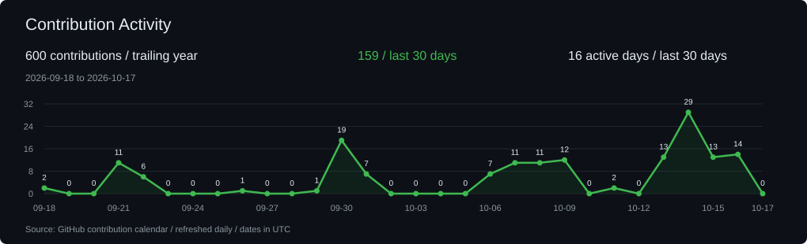

  

  <b>Full-Stack, Data & AI Engineer building products, analytics pipelines, and reliable AI systems.</b> 
  B.Tech CSE - Data Science & Analytics @ IIIT Nagpur - 2027 Data Analytics & Engineering - Full-Stack Products - AI / ML & Agent Systems

  

  
  
  
  

---

## About Me

I'm **Tushar Ghosh**, pursuing **B.Tech CSE - Data Science & Analytics at IIIT Nagpur**, expected **2027**. I build intelligent agents, reliable AI systems, data pipelines, and agentic full-stack applications.

🔭 Currently working as a **Generative AI & Machine Learning Engineer Intern (Remote)** at **MyManah**, architecting multi-agent LLM systems, hybrid RAG pipelines, and automated model evaluation frameworks.

## 💼 Experience

### MyManah
**Generative AI & Machine Learning Engineer Intern**  
**Oct 2026 – Present · Remote**

- **Multi-agent orchestration:** Architecting LangGraph systems in Python with stateful execution, conditional routing, and guardrails for controlled agent behavior.
- **Grounded retrieval:** Developing hybrid RAG pipelines combining dense and sparse retrieval with re-ranking to support evidence-grounded domain reasoning.
- **Evaluation & APIs:** Building automated model evaluation suites measuring hallucination rate, context precision, and latency, backed by production FastAPI microservices.

**Core engineering stack**

---

## What I build

- **AI automation** - Event-driven agent workflows, n8n/Zapier orchestration, webhook integrations, human approval gates, durable execution, and traceable outcomes.
- **Data analytics & engineering** - SQL transformations, CDC and ETL pipelines, analytics models, Power BI/Metabase dashboards, statistical analysis, and forecasting that connect data to business decisions.
- **Full-stack products** - React/TypeScript interfaces, Node.js/Express and FastAPI services, databases, authentication, billing, webhooks, and third-party integrations.
- **AI / ML systems** - Stateful agents, evidence-grounded retrieval, local model inference, vision-language fine-tuning, human review, evaluation, and failure handling.

I care as much about what happens when the model is wrong as when it is right.

---

## AI Automation & Agentic Workflows

Event-driven systems that connect business triggers to evidence collection, agent execution, human review, and auditable delivery. AI proposes; explicit policies and approval boundaries control consequential actions.

| Project | Automation workflow | Tech |
| --- | --- | --- |
| [SignalBrief - Competitive Intelligence Automation](https://github.com/tusharg007/signalbrief-competitive-intelligence) | Automates RSS-triggered research through Zapier, CrewAI evidence collection and AutoGen critique; pauses for version-bound human approval before Slack delivery. Neon checkpoints, worker leases and a transactional outbox preserve workflow state. [Approved workspace](https://signalbrief-dncb.onrender.com/showcase?run=d1434228a9ad4f92acc120d45af1c437) / [Walkthrough](https://github.com/tusharg007/signalbrief-competitive-intelligence/blob/main/docs/demo/signalbrief-walkthrough.mp4). | FastAPI, CrewAI, AutoGen, Zapier, Neon PostgreSQL, Slack |
| [North Star - Governed Expense Automation](https://github.com/tusharg007/northstar-workload-optimizer) | Orchestrates expense intake, policy checks, human approval and optional Slack/email notifications across 13 durable n8n workflows. AI explains and investigates; deterministic FastAPI policy owns financial outcomes. Includes retry/dead-letter replay and SHA-256 provenance. Locally verified reference build. | FastAPI, n8n, PostgreSQL, React, MCP |
| [RevenueGuard AI - Payment Recovery Automation](https://github.com/tusharg007/revenueguard-ai) | Turns signed Razorpay failure webhooks into persisted recovery cases and Redis-worker tasks. ML triage and LangGraph propose retry/defer/stop strategies; deterministic guardrails and high-value human approval gate actions and preserve an audit trail. Public product; demo and evaluation use synthetic/test-mode events, not production recovery results. | FastAPI, LangGraph, Redis, PostgreSQL, Razorpay, React |
| [StyleHub - AI Campaign & Lifecycle Automation](https://github.com/tusharg007/xeno-crm-backend) | Converts audience requests into SQL-grounded segments and drafted campaigns with human launch approval. Six lifecycle journey templates automate segment-to-campaign flows; the separate [channel service](https://github.com/tusharg007/xeno-channel-service) simulates asynchronous delivery and receipt callbacks for inspectable status and analytics. | FastAPI, LangGraph, Streamlit, SQLite, SQLAlchemy |
| [TripBandhu - Human-Reviewed Travel Research Automation](https://github.com/tusharg007/TripBandhu) | Routes travel requests across five LangGraph specialists, gathers typed provider evidence and pauses for itinerary review. PostgreSQL checkpoints support interrupt/resume, while approved plans become session-bound PDFs without repeating inference. Automates research and planning, not bookings. | Python, FastAPI, LangGraph, PostgreSQL |

---

## Full-Stack & Platform Engineering

| Project | What it demonstrates | Tech |
| --- | --- | --- |
| [CortexAI - AI Developer Platform & Integration Workspace](https://github.com/tusharg007/Cortex) | Full-stack AI workspace with a React client, Express API gateway, auth/chat/agent/billing services, MongoDB and Redis persistence, LangGraph routing, RAG, multimodal workflows, and generated artifacts. | Node.js, Express, React, MongoDB, Redis, LangGraph, Qdrant |
| [SifraAI - Deployed Voice AI Product](https://github.com/tusharg007/SifraAI) | Deployed MERN-style voice assistant product with Firebase auth, cookie/JWT sessions, MongoDB, Razorpay billing, Gemini, an embeddable JavaScript widget, and third-party website integration. | React, Node.js, Express, MongoDB, Firebase, Razorpay, Gemini |
| [AI Platform Reliability Copilot](https://github.com/tusharg007/ai-platform-reliability-copilot) | FastAPI incident clustering, risk scoring and runbook retrieval with Redis, OpenTelemetry, Prometheus/Grafana, Slack and a six-stage CI pipeline. Public API health reports v2.0.0 with a mock LLM provider; the demonstration uses synthetic telemetry. | Python, FastAPI, Redis, OpenTelemetry, Prometheus, Grafana, Helm |

---

## Data Analytics & Engineering

| Project | What it demonstrates | Tech |
| --- | --- | --- |
| [Retail Lakehouse Engineering](https://github.com/tusharg007/retail-lakehouse-engineering) | Replay-safe PostgreSQL CDC through Airflow and Spark/Delta into dbt silver/gold models; 42,796 local CDC events, 38/38 dbt build, SCD snapshots, metric-grain checks, and a PostgreSQL EXPLAIN/OLTP-to-OLAP lab. | PostgreSQL, Airflow, PySpark, Delta Lake, dbt, AWS S3 |
| [RideIQ 2.0 - NYC Demand Forecasting & Fleet Intelligence](https://github.com/tusharg007/rideiq-nyc-demand-forecasting) | Analytics over 9.55M taxi trips with leakage-safe zone-hour forecasting, route clustering, a dashboard/API, and constrained allocation simulation. Random forest test WAPE: 18.2% versus 21.3% for the strongest temporal baseline. | Python, Pandas, Scikit-learn, Streamlit, FastAPI |
| [Retail Analytics & Data Pipeline System](https://github.com/tusharg007/End-to-End-BI-Dashboard) | Azure-ready ingestion and PySpark transformation into a five-dimension/one-fact star schema; 10,201 orders, 18 DAX measures, a three-page Power BI report and a two-page Azure DirectQuery report. Uses simulated/public data. | Azure Data Factory, Azure SQL, PySpark, Power BI, SQL, DAX |
| [Vendor Performance Analysis](https://github.com/tusharg007/vendor-performance-analysis) | Python/SQL ingestion, vendor-brand aggregation, Power BI and statistical analysis of concentration, profitability and inventory. The analyzed population shows 65.69% purchase concentration in the top 10 vendors and $2.71M estimated unsold stock; observational findings. | Python, SQLAlchemy, SQLite, SQL, Power BI, SciPy |
| [BrandPulse Analytics](https://github.com/tusharg007/brandpulse-analytics) | Full-stack e-commerce analytics with Pandas ETL, PostgreSQL, a Flask REST API, Redis-cached KPIs, React charts, CSV export and ETL run history. Docker Compose supports local operation; Azure deployment is a proposed extension. | React, Flask, PostgreSQL, Redis, Pandas, Docker |
| [Manufacturing Quality & Equipment Anomaly Intelligence](https://github.com/tusharg007/Equipment-Anomaly-Intelligence) | Synthetic manufacturing telemetry transformed through PostgreSQL/dbt into quality, anomaly, downtime and OEE-style analytics served by FastAPI and Metabase; 14 dbt models and 31 data tests verified locally. | Python, PostgreSQL, dbt, Scikit-learn, FastAPI, Metabase |

---

## AI, Agent & Retrieval Systems

| Project | What it demonstrates |
| --- | --- |
| [MyManah Journal Intelligence](https://github.com/tusharg007/mymanah-journal-intelligence) | Local-model journal analysis and cited PDF Q&A with FastAPI/React, Ollama, Hugging Face classifiers, SQLite, Chroma and hybrid retrieval. Current policy revision reports 96 deterministic Windows tests; actual-model, offline and backup/restore checks are documented. Engineering prototype, not clinically validated. |
| [Internal RFP Analyst](https://github.com/tusharg007/Internal-RFP-Analyst) | Cyclic RAG with citation verification and 145 tests on main. The separate [Neo4j GraphRAG edition](https://github.com/tusharg007/Internal-RFP-Analyst/tree/feature/graphrag-neo4j) adds vector/graph/hybrid modes and reports 641 passed, 5 skipped; its public walkthrough used transparent vector fallback, and comparative retrieval superiority is not claimed. |
| [Financial Document Intelligence](https://github.com/tusharg007/financial-document-intelligence-rag) | SEC EDGAR ingestion, section-aware chunks, dense/BM25 retrieval, grounded citations, abstention and evaluation tools; 79 tests reported. Full indexing runs locally; the hosted UI is a lightweight preview. |
| [EnergyShield](https://github.com/tusharg007/energyshield-et-hackathon) | Three coordinated workflows connect geopolitical signal interpretation, deterministic disruption scenarios and weighted supplier ranking, with persisted reasoning and decision support. Hackathon prototype using mock/API-ready signals. |

---

## How I build

AI is part of my normal build loop, but I do not treat "the agent says it works" as completion. I use coding agents for repo exploration, implementation, tests, repetitive changes, and debugging, then verify behavior with tests, CI, traces, logs, and the running system. The architectural and product decisions stay mine.

---

## Technical Skills

  

| Area | Tools and Technologies |
| --- | --- |
| Backend & APIs | Node.js, Express, FastAPI, REST APIs, service boundaries, authentication, sessions, webhooks, billing |
| Full-stack | React, TypeScript, JavaScript, MongoDB, PostgreSQL, Redis, SQL, SQLAlchemy |
| Agents & GenAI | LangGraph, LangChain, MCP, RAG, tool calling, structured outputs, HITL, guardrails, provenance, agent evaluation |
| Reliability & Infrastructure | pytest, GitHub Actions, Docker, LangSmith, observability, SSE, n8n, failure handling |
| Integrations | AWS S3, Qdrant, Tavily, Metabase, Resend, Slack, Firebase, Razorpay |
| Data Engineering | PostgreSQL CDC, Airflow, PySpark, Delta Lake, dbt, replay-safe ingestion |
| Analytics & BI | Pandas, NumPy, SQL, Power BI, DAX, Metabase, statistical tests, forecasting, data quality, dimensional modeling |
| Local & Multimodal ML | PyTorch, Transformers, PEFT/LoRA, SmolVLM, Ollama, Chroma, Whisper, pyannote |

---

## Selected Applied ML & Multimodal Work

| Project | What it demonstrates | Tech |
| --- | --- | --- |
| [ReceiptKIE-VLM - V2 High-Resolution Receipt Extraction](https://github.com/tusharg007/receipt-kie-vlm) | Continued LoRA adaptation of SmolVLM at 1536 px; 99.2% valid JSON, 63.3% macro field exact match and 18.3% complete-record exact match on 246 previously unseen SROIE test receipts. V1 remains a reproducible baseline. | PyTorch, Transformers, PEFT/LoRA, SmolVLM, SROIE |
| [SpeakerScan](https://github.com/tusharg007/speakerscan) | Speech annotation combining pyannote diarization, wav2vec2 emotion and Whisper language ID with sequential model loading, resumable stage checkpoints and atomic JSON/RTTM exports plus a CSV manifest. | Python, PyTorch, pyannote, wav2vec2, Whisper, Streamlit |

---

## About / Current Direction

Currently a **Generative AI & Machine Learning Engineer Intern at MyManah**, working remotely on agent orchestration, grounded retrieval, evaluation, and FastAPI services. My broader engineering interests span **AI systems, full-stack development, and data analytics / engineering**.

Project summaries checked against current repository documentation on **9 October 2026**. Local tests, offline evaluations and prototypes are identified separately from deployed products.

---

## GitHub Activity

  

  
  
  

  
  <!-- Keep the existing counter collecting requests independently of the cached display badge. -->
  

Contribution data refreshes daily from GitHub. Profile views are approximate image requests, not unique visitors; the badge is cached and may lag.

---

## Contact

I am open to Full-Stack, Data Analytics / Engineering, and AI / ML internships and collaborations involving useful products, trustworthy data and reliable systems.

- Email: [tg304429@gmail.com](mailto:tg304429@gmail.com)
- Portfolio: [tushar-portfolio-taupe.vercel.app](https://tushar-portfolio-taupe.vercel.app)
- LinkedIn: [linkedin.com/in/tushar-ghosh-a3355124a](https://linkedin.com/in/tushar-ghosh-a3355124a/)
- GitHub: [github.com/tusharg007](https://github.com/tusharg007)
